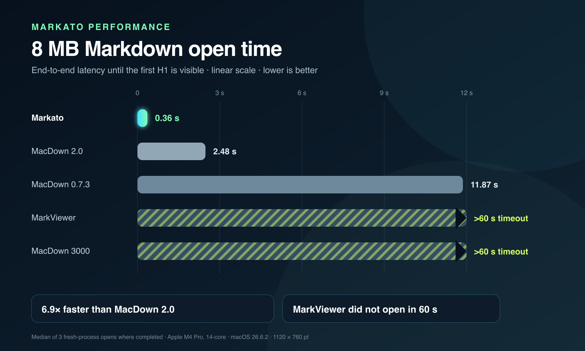
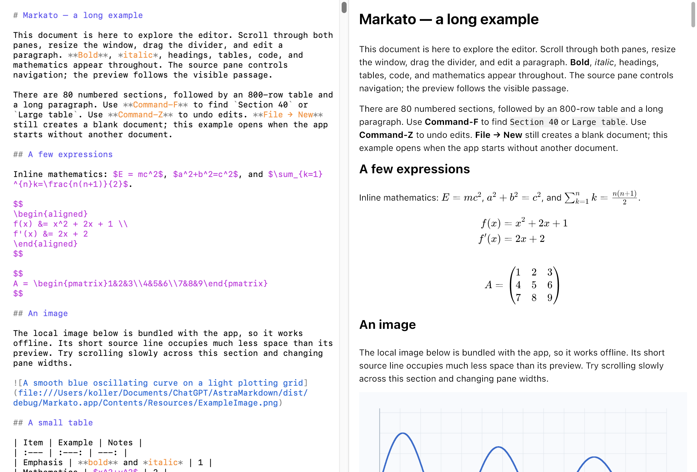

# Markato


**Fast Markdown editing, even on long documents.**

Markato is a native Markdown editor for Mac, built around speed: open large documents quickly, edit their source, and see a live preview alongside your text.

If you like [MacDown](https://github.com/MacDownApp/macdown)'s source-on-the-left, preview-on-the-right approach, Markato offers that familiar way of writing with a focus on performance as documents grow. Equations, tables, code blocks, and images belong in the same document, without making you wait for the whole preview to appear.

## Speed on long documents

In a controlled benchmark on an Apple M4 Pro, Markato opened an **8 MB Markdown document to a visible preview in 0.26 seconds** — **9.7 times faster than [MacDown 2.0](https://github.com/xuanji86/MacDown2.0)** and **46 times faster than MacDown 0.7.3**. Neither [MarkViewer](https://markviewer.com/) nor [MacDown 3000](https://github.com/schuyler/macdown3000) completed that operation within the 60-second limit.



On the same 8 MB document, an edit reached the visible preview in **0.21 seconds**, compared with **0.23 seconds for MacDown 2.0**. The largest advantage in this comparison is opening long documents.

See the [complete performance comparison](docs/performance.md) for opening and editing results at 64 KB, 1 MB, and 8 MB, the tested versions, and the benchmark method. These figures describe the tested documents and hardware.

## Write and preview



- **Source and preview together.** Edit your Markdown directly, with syntax coloring and a preview that follows the passage you are reading. Drag the divider to adjust the panes, or hide the preview to focus on the source.
- **Equations alongside your text.** Write inline and display math, including aligned equations and matrices, without installing TeX.
- **Tables, code, and images.** Preview Markdown tables, syntax-highlighted code fences, and local or web images. Wide tables and code blocks scroll horizontally.
- **Code highlighting.** Native Syntect highlighting with extended grammars, including Swift, TypeScript, and Typst, and light and dark themes. See [languages, fallbacks, and test documents](docs/highlighting.md).
- **Mermaid diagrams.** Render fenced `mermaid` blocks as SVG with a bundled native renderer. See [syntax, compatibility, and test documents](docs/mermaid.md).
- **Review comments.** Add unrestricted comments to selected text or an insertion point, navigate them from the sidebar, and export them as standard PDF annotations. The [comment format](docs/comments.md) remains invisible to ordinary Markdown renderers and readable by coding agents.
- **Familiar Mac editing.** Open and save individual Markdown files, undo and redo, search the whole document, and adjust text sizes. Fonts and preview styles are bundled for offline use.

## Try Markato

Markato requires **macOS 15 or later on an Apple Silicon Mac**. It is currently a development prototype; build it from source using the instructions below.

The app opens an empty document when launched without a file. Choose **File → Open** to open a Markdown file, or **File → Open Recent** to return to a previously opened file. The bundled example remains available through the development launcher described below.

Use **⌘F** to search, **⌘G** and **⇧⌘G** to move between matches, and **⌥⌘P** to show or hide the preview.

Complex nested Markdown, very large individual paragraphs or table cells, input methods, rapid scrolling, and continuous resizing still need broader validation.

## Build from source

You need Xcode with the macOS SDK, Swift 6 or later, Rust, and the Ultralight SDK. The tested versions are Rust 1.96 and Ultralight 2.0 beta 2. Follow the [SDK setup instructions](Vendor/Ultralight/README.md), then run:

```sh
bash scripts/build-app.sh
open dist/Markato.app
```

The build packages the app at `dist/Markato.app` with a local ad hoc signature. The resulting app needs neither Rust nor an external TeX installation.

For work on the source, see:

- [Development guide](docs/development.md): build options, tests, timing diagnostics, and dependency maintenance.
- [Architecture](docs/architecture.md): editing, document storage, parsing, and preview presentation.
- [Synchronized scrolling](docs/scrolling-algorithm.md): how source and preview navigation work.
- [Ultralight preview architecture](docs/ultralight-preview-architecture.md): the preview module and its interfaces.
