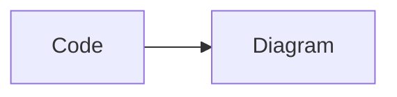

# Highlighting edge cases

## Multiline state

```python
value = """first line
second line 😀
third line"""
print(value) # outside the string
```

## Fresh state in another fence

```python
print("Fresh state")
```

## Quoted fence

> ```rust
> fn quoted() -> bool { true }
> ```

## List fence

1. Embedded code:

   ~~~js extra-info
   const nested = "List item";
   ~~~

## Literal HTML inside highlighted code

```html
<script>alert("This must be literal code")</script>

```

## Unknown language must remain plain text

```unknown-language
<script>alert("This must also remain literal code")</script>
```

## Explicit plain text and unlabeled code

```text
fn main() { let x = "Plain text"; }
```

```
#!/bin/bash
echo "No automatic language detection"
```

## Extended grammars

These fences use the additional grammars bundled by two-face.

```swift
let message = "Swift grammar is bundled"
```

```typescript
const message: string = "TypeScript grammar is bundled";
```

## Dedicated renderers and math



```math
x^2 + y^2 = z^2
```

Inline `$literal$` is code, while $x^2$ is math.

End of edge case fixture.
