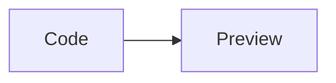

# Native syntax highlighting

```python
# NATIVE_HIGHLIGHT_COMMENT
message = "NATIVE_HIGHLIGHT_STRING"
print(message)
```

```rust
fn main() {
    let ready = true;
    println!("NATIVE_HIGHLIGHT_RUST");
}
```

```swift
let message: String = "NATIVE_SWIFT_STRING"
```

```typst
#let message = "NATIVE_TYPST_STRING"
#message
```

```unknown-language
<script>NATIVE_LITERAL_HTML</script>
```



Math remains $x^2$. **The surrounding paragraph survives.**
