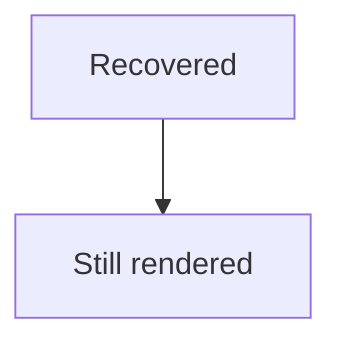

# Mermaid error isolation

Each failed diagram should show a short message and its original source. Ordinary Markdown and valid diagrams after it must still render.

## Unsupported type

```mermaid
unknownDiagram
    A --> B
```

## Empty source

```mermaid
```

## Incomplete flowchart header

```mermaid
flowchart
    A[
```

## Comment-only source

```mermaid
%% Nothing to draw yet
```

## Source with HTML

```mermaid
unknownDiagram
<script>alert("Mermaid source must remain text")</script>

```

## Valid diagram after failures



**End of error fixture.**
