# Mermaid diagram families

Every Mermaid fence in this document should become a diagram. Check readable labels, complete arrows and legends, and absence of clipped content. The renderer is rusty-mermaid 0.2.0; this corpus tests representative syntax, not complete Mermaid.js compatibility.

## Flowchart

Decisions and joins.

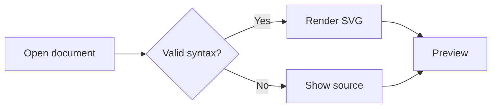

## Sequence

Messages, activation and notes.

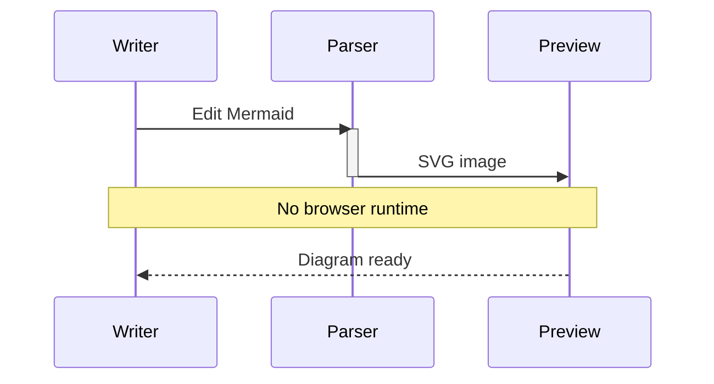

## State

Start, transitions and end.

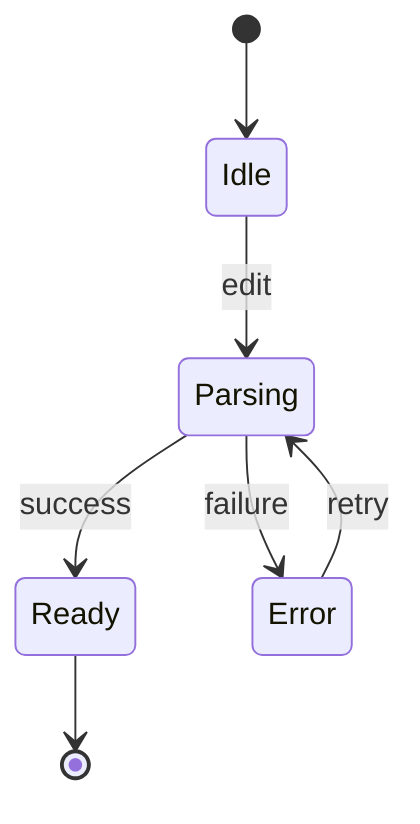

## Class

Members and inheritance.

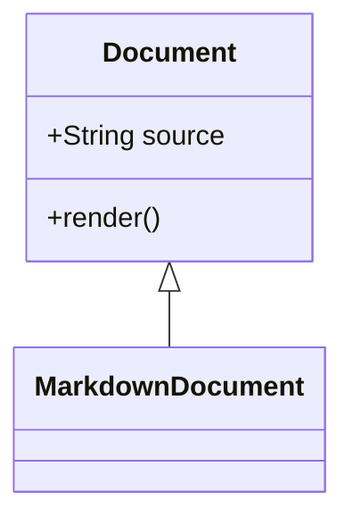

## Er

Entities and relationships.

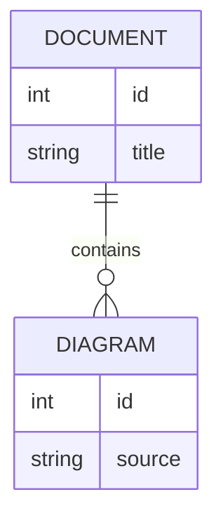

## Pie

Slices and legend.

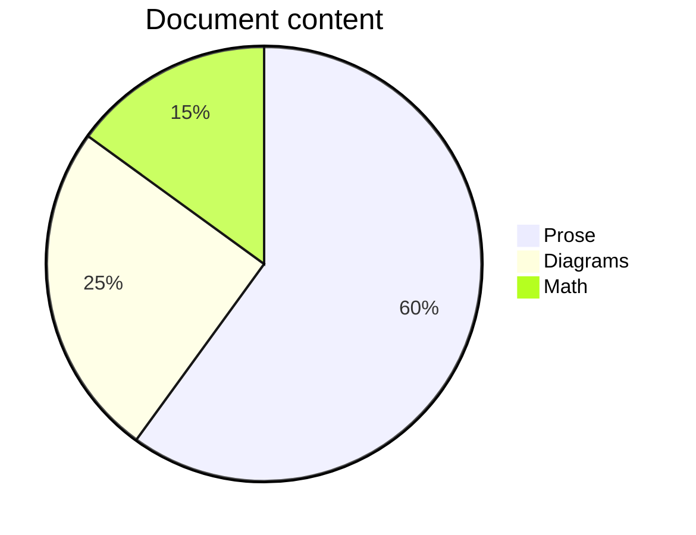

## Mindmap

Indented hierarchy.

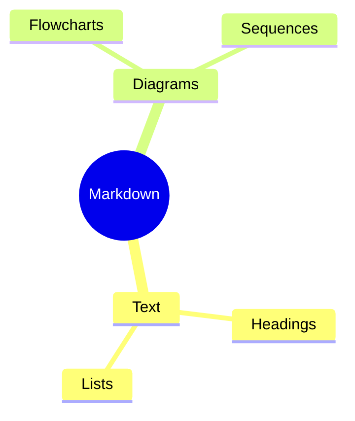

## Gantt

Dates, sections and dependencies.

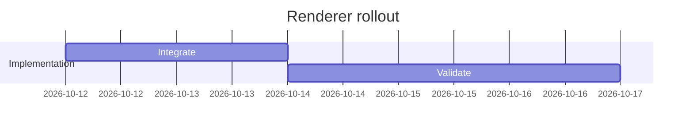

## Timeline

Periods and events.

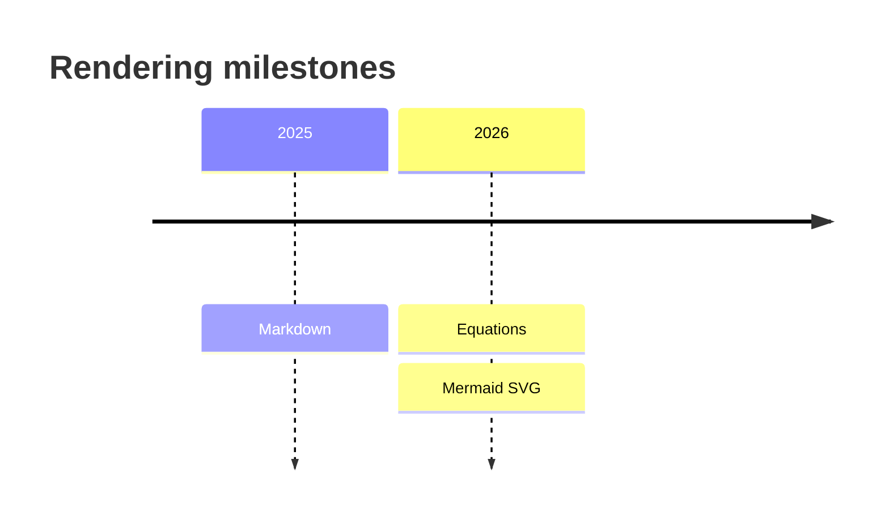

## Gitgraph

Branches and merge.

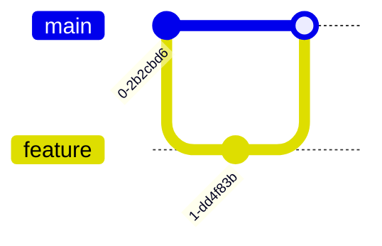

## Xychart

Axes, bars and lines.

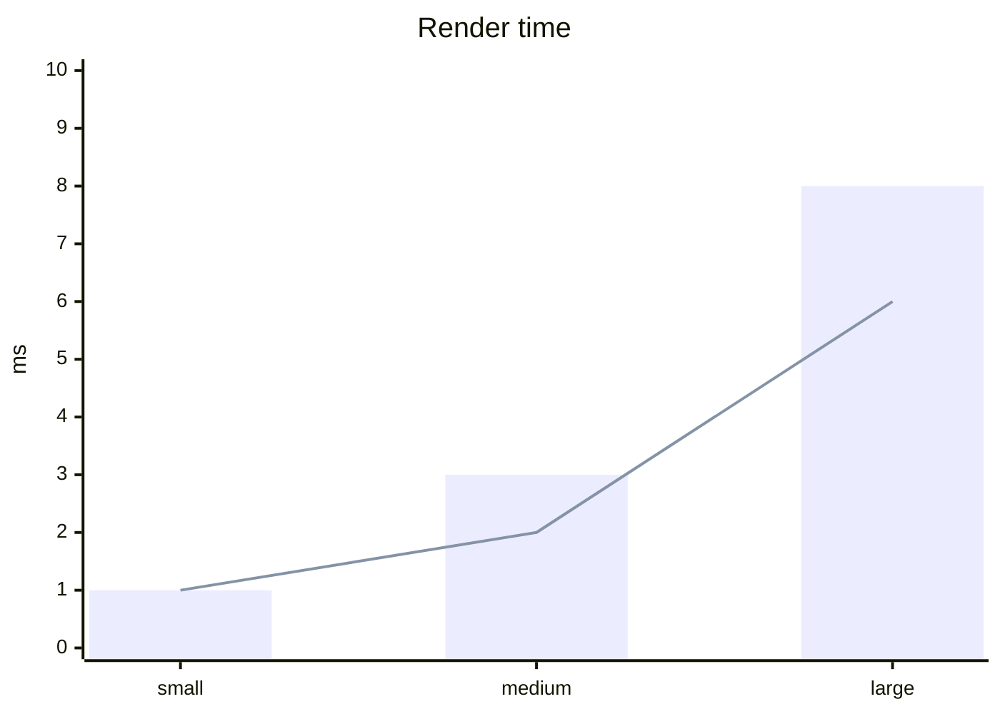

## Sankey

Weighted flows.

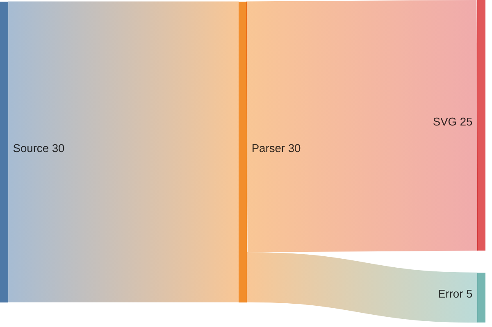

## Quadrant

Axes and points.

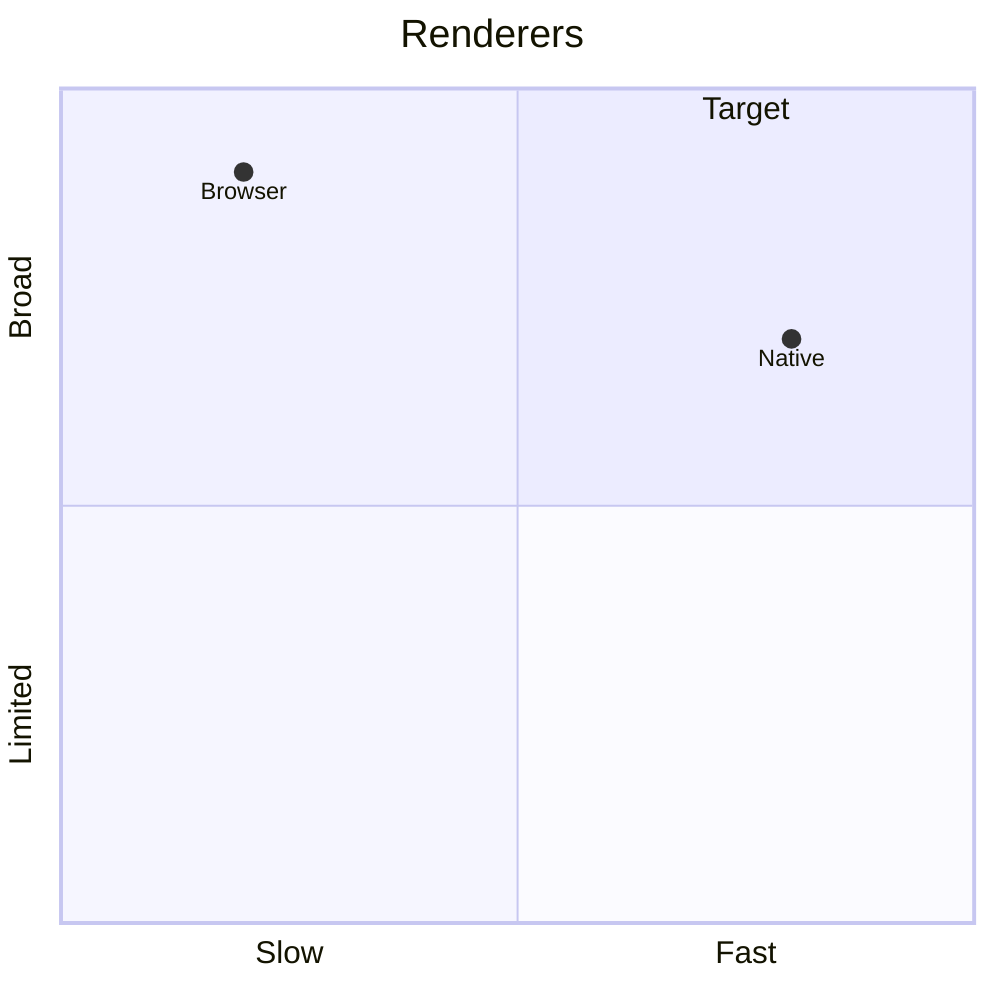

## Journey

Sections, scores and actors.

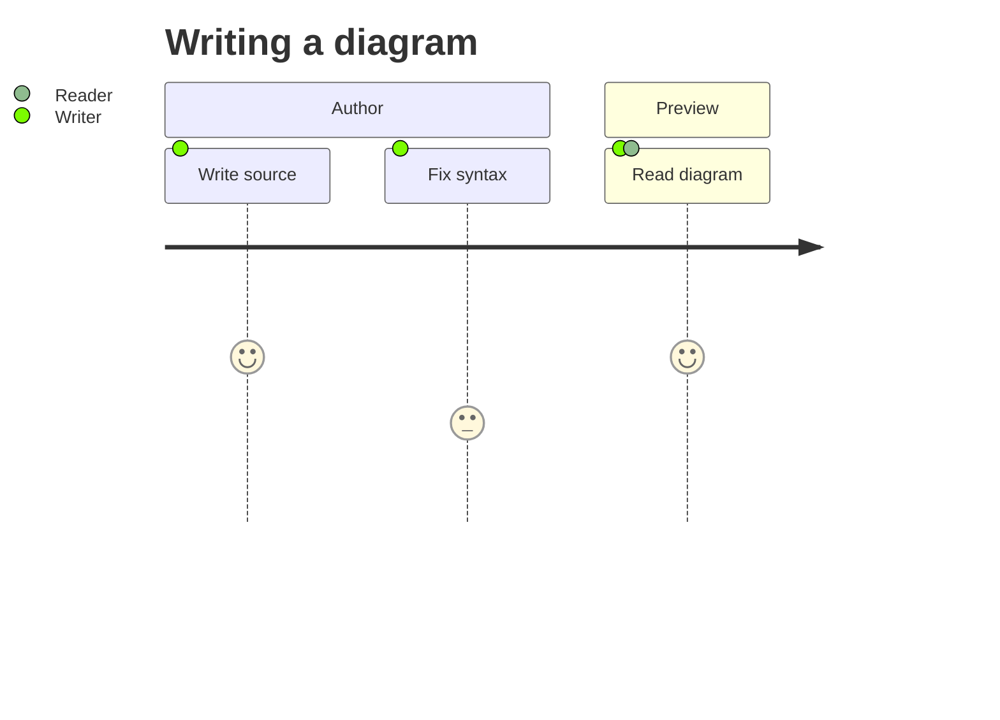
