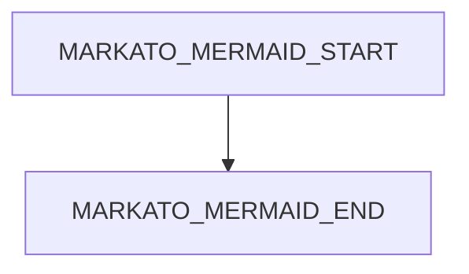
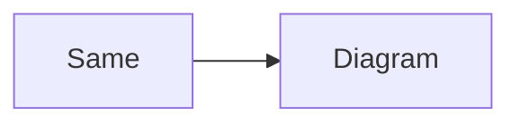
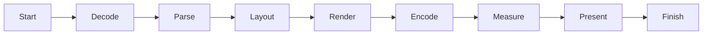
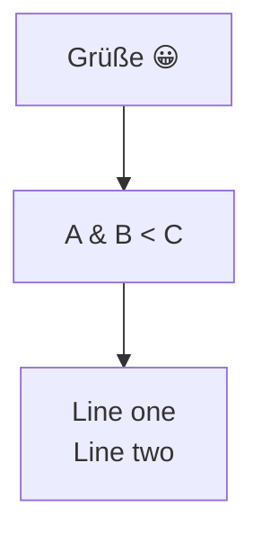
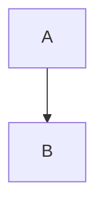

# Mermaid layout and surrounding Markdown

A **bold** paragraph with $x^2$ before the first diagram.



## Repeated diagrams

The next two images have identical arrow marker names internally. Both must show complete arrowheads.




## Wide diagram

Resize the window: the whole image should scale down proportionally without changing its aspect ratio.



## Nested diagram

> A diagram inside a quote:
>
> ```mermaid
> sequenceDiagram
>     Alice->>Bob: Quoted message
>     Bob-->>Alice: Reply
> ```

1. A list item containing a diagram:

   ```mermaid
   graph TD
       List --> Diagram
   ```

## Alternative fences and info strings

~~~mermaid title="Extra info is ignored"
graph LR
    Tilde --> Fence
~~~

## Unicode, escaped labels and multiline text



## Ordinary code stays code

```swift
let diagram = "graph TD; A --> B"
```



| Feature | Result |
| --- | --- |
| Mermaid | SVG image |
| Math | KaTeX |

$$
a^2 + b^2 = c^2
$$

End of layout fixture. This paragraph must remain visible after diagrams render.
