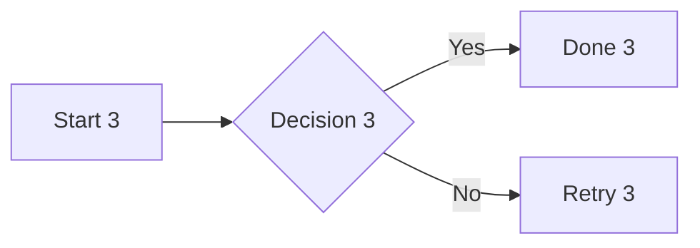
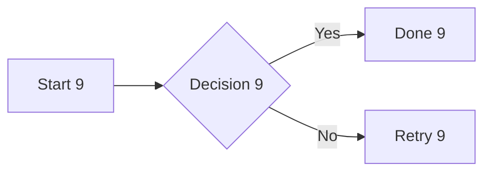
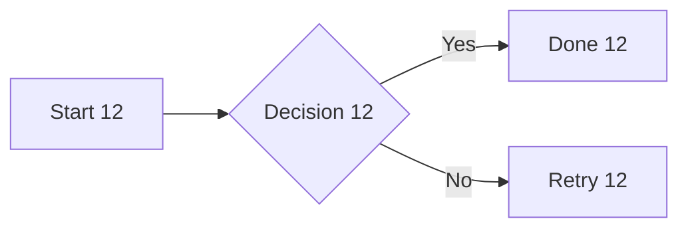
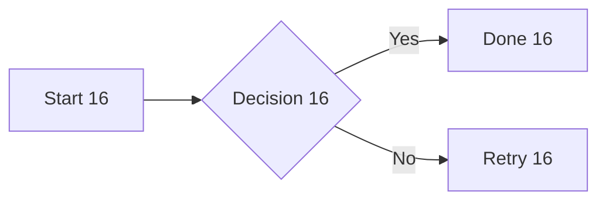
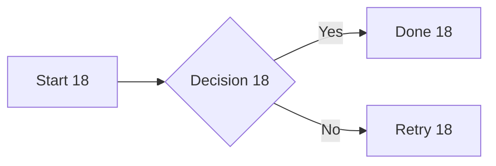

# Mermaid stress document

100 unique diagrams interleaved with prose. Scroll to the end, resize, edit a label near the beginning and near the end, undo and redo. Every diagram should remain associated with its original source range.

## Diagram 0

Paragraph 0 before the diagram.


Paragraph 0 after the diagram.

## Diagram 1

Paragraph 1 before the diagram.


Paragraph 1 after the diagram.

## Diagram 2

Paragraph 2 before the diagram.


Paragraph 2 after the diagram.

## Diagram 3

Paragraph 3 before the diagram.



Paragraph 3 after the diagram.

## Diagram 4

Paragraph 4 before the diagram.


Paragraph 4 after the diagram.

## Diagram 5

Paragraph 5 before the diagram.


Paragraph 5 after the diagram.

## Diagram 6

Paragraph 6 before the diagram.


Paragraph 6 after the diagram.

## Diagram 7

Paragraph 7 before the diagram.


Paragraph 7 after the diagram.

## Diagram 8

Paragraph 8 before the diagram.


Paragraph 8 after the diagram.

## Diagram 9

Paragraph 9 before the diagram.



Paragraph 9 after the diagram.

## Diagram 10

Paragraph 10 before the diagram.


Paragraph 10 after the diagram.

## Diagram 11

Paragraph 11 before the diagram.


Paragraph 11 after the diagram.

## Diagram 12

Paragraph 12 before the diagram.



Paragraph 12 after the diagram.

## Diagram 13

Paragraph 13 before the diagram.


Paragraph 13 after the diagram.

## Diagram 14

Paragraph 14 before the diagram.


Paragraph 14 after the diagram.

## Diagram 15

Paragraph 15 before the diagram.


Paragraph 15 after the diagram.

## Diagram 16

Paragraph 16 before the diagram.



Paragraph 16 after the diagram.

## Diagram 17

Paragraph 17 before the diagram.


Paragraph 17 after the diagram.

## Diagram 18

Paragraph 18 before the diagram.



Paragraph 18 after the diagram.

## Diagram 19

Paragraph 19 before the diagram.


Paragraph 19 after the diagram.

## Diagram 20

Paragraph 20 before the diagram.

```mermaid
flowchart LR
    A[Start 20] --> B{Decision 20}
    B -->|Yes| C[Done 20]
    B -->|No| D[Retry 20]
```

Paragraph 20 after the diagram.

## Diagram 21

Paragraph 21 before the diagram.

```mermaid
flowchart LR
    A[Start 21] --> B{Decision 21}
    B -->|Yes| C[Done 21]
    B -->|No| D[Retry 21]
```

Paragraph 21 after the diagram.

## Diagram 22

Paragraph 22 before the diagram.

```mermaid
flowchart LR
    A[Start 22] --> B{Decision 22}
    B -->|Yes| C[Done 22]
    B -->|No| D[Retry 22]
```

Paragraph 22 after the diagram.

## Diagram 23

Paragraph 23 before the diagram.

```mermaid
flowchart LR
    A[Start 23] --> B{Decision 23}
    B -->|Yes| C[Done 23]
    B -->|No| D[Retry 23]
```

Paragraph 23 after the diagram.

## Diagram 24

Paragraph 24 before the diagram.

```mermaid
flowchart LR
    A[Start 24] --> B{Decision 24}
    B -->|Yes| C[Done 24]
    B -->|No| D[Retry 24]
```

Paragraph 24 after the diagram.

## Diagram 25

Paragraph 25 before the diagram.

```mermaid
flowchart LR
    A[Start 25] --> B{Decision 25}
    B -->|Yes| C[Done 25]
    B -->|No| D[Retry 25]
```

Paragraph 25 after the diagram.

## Diagram 26

Paragraph 26 before the diagram.

```mermaid
flowchart LR
    A[Start 26] --> B{Decision 26}
    B -->|Yes| C[Done 26]
    B -->|No| D[Retry 26]
```

Paragraph 26 after the diagram.

## Diagram 27

Paragraph 27 before the diagram.

```mermaid
flowchart LR
    A[Start 27] --> B{Decision 27}
    B -->|Yes| C[Done 27]
    B -->|No| D[Retry 27]
```

Paragraph 27 after the diagram.

## Diagram 28

Paragraph 28 before the diagram.

```mermaid
flowchart LR
    A[Start 28] --> B{Decision 28}
    B -->|Yes| C[Done 28]
    B -->|No| D[Retry 28]
```

Paragraph 28 after the diagram.

## Diagram 29

Paragraph 29 before the diagram.

```mermaid
flowchart LR
    A[Start 29] --> B{Decision 29}
    B -->|Yes| C[Done 29]
    B -->|No| D[Retry 29]
```

Paragraph 29 after the diagram.

## Diagram 30

Paragraph 30 before the diagram.

```mermaid
flowchart LR
    A[Start 30] --> B{Decision 30}
    B -->|Yes| C[Done 30]
    B -->|No| D[Retry 30]
```

Paragraph 30 after the diagram.

## Diagram 31

Paragraph 31 before the diagram.

```mermaid
flowchart LR
    A[Start 31] --> B{Decision 31}
    B -->|Yes| C[Done 31]
    B -->|No| D[Retry 31]
```

Paragraph 31 after the diagram.

## Diagram 32

Paragraph 32 before the diagram.

```mermaid
flowchart LR
    A[Start 32] --> B{Decision 32}
    B -->|Yes| C[Done 32]
    B -->|No| D[Retry 32]
```

Paragraph 32 after the diagram.

## Diagram 33

Paragraph 33 before the diagram.

```mermaid
flowchart LR
    A[Start 33] --> B{Decision 33}
    B -->|Yes| C[Done 33]
    B -->|No| D[Retry 33]
```

Paragraph 33 after the diagram.

## Diagram 34

Paragraph 34 before the diagram.

```mermaid
flowchart LR
    A[Start 34] --> B{Decision 34}
    B -->|Yes| C[Done 34]
    B -->|No| D[Retry 34]
```

Paragraph 34 after the diagram.

## Diagram 35

Paragraph 35 before the diagram.

```mermaid
flowchart LR
    A[Start 35] --> B{Decision 35}
    B -->|Yes| C[Done 35]
    B -->|No| D[Retry 35]
```

Paragraph 35 after the diagram.

## Diagram 36

Paragraph 36 before the diagram.

```mermaid
flowchart LR
    A[Start 36] --> B{Decision 36}
    B -->|Yes| C[Done 36]
    B -->|No| D[Retry 36]
```

Paragraph 36 after the diagram.

## Diagram 37

Paragraph 37 before the diagram.

```mermaid
flowchart LR
    A[Start 37] --> B{Decision 37}
    B -->|Yes| C[Done 37]
    B -->|No| D[Retry 37]
```

Paragraph 37 after the diagram.

## Diagram 38

Paragraph 38 before the diagram.

```mermaid
flowchart LR
    A[Start 38] --> B{Decision 38}
    B -->|Yes| C[Done 38]
    B -->|No| D[Retry 38]
```

Paragraph 38 after the diagram.

## Diagram 39

Paragraph 39 before the diagram.

```mermaid
flowchart LR
    A[Start 39] --> B{Decision 39}
    B -->|Yes| C[Done 39]
    B -->|No| D[Retry 39]
```

Paragraph 39 after the diagram.

## Diagram 40

Paragraph 40 before the diagram.

```mermaid
flowchart LR
    A[Start 40] --> B{Decision 40}
    B -->|Yes| C[Done 40]
    B -->|No| D[Retry 40]
```

Paragraph 40 after the diagram.

## Diagram 41

Paragraph 41 before the diagram.

```mermaid
flowchart LR
    A[Start 41] --> B{Decision 41}
    B -->|Yes| C[Done 41]
    B -->|No| D[Retry 41]
```

Paragraph 41 after the diagram.

## Diagram 42

Paragraph 42 before the diagram.

```mermaid
flowchart LR
    A[Start 42] --> B{Decision 42}
    B -->|Yes| C[Done 42]
    B -->|No| D[Retry 42]
```

Paragraph 42 after the diagram.

## Diagram 43

Paragraph 43 before the diagram.

```mermaid
flowchart LR
    A[Start 43] --> B{Decision 43}
    B -->|Yes| C[Done 43]
    B -->|No| D[Retry 43]
```

Paragraph 43 after the diagram.

## Diagram 44

Paragraph 44 before the diagram.

```mermaid
flowchart LR
    A[Start 44] --> B{Decision 44}
    B -->|Yes| C[Done 44]
    B -->|No| D[Retry 44]
```

Paragraph 44 after the diagram.

## Diagram 45

Paragraph 45 before the diagram.

```mermaid
flowchart LR
    A[Start 45] --> B{Decision 45}
    B -->|Yes| C[Done 45]
    B -->|No| D[Retry 45]
```

Paragraph 45 after the diagram.

## Diagram 46

Paragraph 46 before the diagram.

```mermaid
flowchart LR
    A[Start 46] --> B{Decision 46}
    B -->|Yes| C[Done 46]
    B -->|No| D[Retry 46]
```

Paragraph 46 after the diagram.

## Diagram 47

Paragraph 47 before the diagram.

```mermaid
flowchart LR
    A[Start 47] --> B{Decision 47}
    B -->|Yes| C[Done 47]
    B -->|No| D[Retry 47]
```

Paragraph 47 after the diagram.

## Diagram 48

Paragraph 48 before the diagram.

```mermaid
flowchart LR
    A[Start 48] --> B{Decision 48}
    B -->|Yes| C[Done 48]
    B -->|No| D[Retry 48]
```

Paragraph 48 after the diagram.

## Diagram 49

Paragraph 49 before the diagram.

```mermaid
flowchart LR
    A[Start 49] --> B{Decision 49}
    B -->|Yes| C[Done 49]
    B -->|No| D[Retry 49]
```

Paragraph 49 after the diagram.

## Diagram 50

Paragraph 50 before the diagram.

```mermaid
flowchart LR
    A[Start 50] --> B{Decision 50}
    B -->|Yes| C[Done 50]
    B -->|No| D[Retry 50]
```

Paragraph 50 after the diagram.

## Diagram 51

Paragraph 51 before the diagram.

```mermaid
flowchart LR
    A[Start 51] --> B{Decision 51}
    B -->|Yes| C[Done 51]
    B -->|No| D[Retry 51]
```

Paragraph 51 after the diagram.

## Diagram 52

Paragraph 52 before the diagram.

```mermaid
flowchart LR
    A[Start 52] --> B{Decision 52}
    B -->|Yes| C[Done 52]
    B -->|No| D[Retry 52]
```

Paragraph 52 after the diagram.

## Diagram 53

Paragraph 53 before the diagram.

```mermaid
flowchart LR
    A[Start 53] --> B{Decision 53}
    B -->|Yes| C[Done 53]
    B -->|No| D[Retry 53]
```

Paragraph 53 after the diagram.

## Diagram 54

Paragraph 54 before the diagram.

```mermaid
flowchart LR
    A[Start 54] --> B{Decision 54}
    B -->|Yes| C[Done 54]
    B -->|No| D[Retry 54]
```

Paragraph 54 after the diagram.

## Diagram 55

Paragraph 55 before the diagram.

```mermaid
flowchart LR
    A[Start 55] --> B{Decision 55}
    B -->|Yes| C[Done 55]
    B -->|No| D[Retry 55]
```

Paragraph 55 after the diagram.

## Diagram 56

Paragraph 56 before the diagram.

```mermaid
flowchart LR
    A[Start 56] --> B{Decision 56}
    B -->|Yes| C[Done 56]
    B -->|No| D[Retry 56]
```

Paragraph 56 after the diagram.

## Diagram 57

Paragraph 57 before the diagram.

```mermaid
flowchart LR
    A[Start 57] --> B{Decision 57}
    B -->|Yes| C[Done 57]
    B -->|No| D[Retry 57]
```

Paragraph 57 after the diagram.

## Diagram 58

Paragraph 58 before the diagram.

```mermaid
flowchart LR
    A[Start 58] --> B{Decision 58}
    B -->|Yes| C[Done 58]
    B -->|No| D[Retry 58]
```

Paragraph 58 after the diagram.

## Diagram 59

Paragraph 59 before the diagram.

```mermaid
flowchart LR
    A[Start 59] --> B{Decision 59}
    B -->|Yes| C[Done 59]
    B -->|No| D[Retry 59]
```

Paragraph 59 after the diagram.

## Diagram 60

Paragraph 60 before the diagram.

```mermaid
flowchart LR
    A[Start 60] --> B{Decision 60}
    B -->|Yes| C[Done 60]
    B -->|No| D[Retry 60]
```

Paragraph 60 after the diagram.

## Diagram 61

Paragraph 61 before the diagram.

```mermaid
flowchart LR
    A[Start 61] --> B{Decision 61}
    B -->|Yes| C[Done 61]
    B -->|No| D[Retry 61]
```

Paragraph 61 after the diagram.

## Diagram 62

Paragraph 62 before the diagram.

```mermaid
flowchart LR
    A[Start 62] --> B{Decision 62}
    B -->|Yes| C[Done 62]
    B -->|No| D[Retry 62]
```

Paragraph 62 after the diagram.

## Diagram 63

Paragraph 63 before the diagram.

```mermaid
flowchart LR
    A[Start 63] --> B{Decision 63}
    B -->|Yes| C[Done 63]
    B -->|No| D[Retry 63]
```

Paragraph 63 after the diagram.

## Diagram 64

Paragraph 64 before the diagram.

```mermaid
flowchart LR
    A[Start 64] --> B{Decision 64}
    B -->|Yes| C[Done 64]
    B -->|No| D[Retry 64]
```

Paragraph 64 after the diagram.

## Diagram 65

Paragraph 65 before the diagram.

```mermaid
flowchart LR
    A[Start 65] --> B{Decision 65}
    B -->|Yes| C[Done 65]
    B -->|No| D[Retry 65]
```

Paragraph 65 after the diagram.

## Diagram 66

Paragraph 66 before the diagram.

```mermaid
flowchart LR
    A[Start 66] --> B{Decision 66}
    B -->|Yes| C[Done 66]
    B -->|No| D[Retry 66]
```

Paragraph 66 after the diagram.

## Diagram 67

Paragraph 67 before the diagram.

```mermaid
flowchart LR
    A[Start 67] --> B{Decision 67}
    B -->|Yes| C[Done 67]
    B -->|No| D[Retry 67]
```

Paragraph 67 after the diagram.

## Diagram 68

Paragraph 68 before the diagram.

```mermaid
flowchart LR
    A[Start 68] --> B{Decision 68}
    B -->|Yes| C[Done 68]
    B -->|No| D[Retry 68]
```

Paragraph 68 after the diagram.

## Diagram 69

Paragraph 69 before the diagram.

```mermaid
flowchart LR
    A[Start 69] --> B{Decision 69}
    B -->|Yes| C[Done 69]
    B -->|No| D[Retry 69]
```

Paragraph 69 after the diagram.

## Diagram 70

Paragraph 70 before the diagram.

```mermaid
flowchart LR
    A[Start 70] --> B{Decision 70}
    B -->|Yes| C[Done 70]
    B -->|No| D[Retry 70]
```

Paragraph 70 after the diagram.

## Diagram 71

Paragraph 71 before the diagram.

```mermaid
flowchart LR
    A[Start 71] --> B{Decision 71}
    B -->|Yes| C[Done 71]
    B -->|No| D[Retry 71]
```

Paragraph 71 after the diagram.

## Diagram 72

Paragraph 72 before the diagram.

```mermaid
flowchart LR
    A[Start 72] --> B{Decision 72}
    B -->|Yes| C[Done 72]
    B -->|No| D[Retry 72]
```

Paragraph 72 after the diagram.

## Diagram 73

Paragraph 73 before the diagram.

```mermaid
flowchart LR
    A[Start 73] --> B{Decision 73}
    B -->|Yes| C[Done 73]
    B -->|No| D[Retry 73]
```

Paragraph 73 after the diagram.

## Diagram 74

Paragraph 74 before the diagram.

```mermaid
flowchart LR
    A[Start 74] --> B{Decision 74}
    B -->|Yes| C[Done 74]
    B -->|No| D[Retry 74]
```

Paragraph 74 after the diagram.

## Diagram 75

Paragraph 75 before the diagram.

```mermaid
flowchart LR
    A[Start 75] --> B{Decision 75}
    B -->|Yes| C[Done 75]
    B -->|No| D[Retry 75]
```

Paragraph 75 after the diagram.

## Diagram 76

Paragraph 76 before the diagram.

```mermaid
flowchart LR
    A[Start 76] --> B{Decision 76}
    B -->|Yes| C[Done 76]
    B -->|No| D[Retry 76]
```

Paragraph 76 after the diagram.

## Diagram 77

Paragraph 77 before the diagram.

```mermaid
flowchart LR
    A[Start 77] --> B{Decision 77}
    B -->|Yes| C[Done 77]
    B -->|No| D[Retry 77]
```

Paragraph 77 after the diagram.

## Diagram 78

Paragraph 78 before the diagram.

```mermaid
flowchart LR
    A[Start 78] --> B{Decision 78}
    B -->|Yes| C[Done 78]
    B -->|No| D[Retry 78]
```

Paragraph 78 after the diagram.

## Diagram 79

Paragraph 79 before the diagram.

```mermaid
flowchart LR
    A[Start 79] --> B{Decision 79}
    B -->|Yes| C[Done 79]
    B -->|No| D[Retry 79]
```

Paragraph 79 after the diagram.

## Diagram 80

Paragraph 80 before the diagram.

```mermaid
flowchart LR
    A[Start 80] --> B{Decision 80}
    B -->|Yes| C[Done 80]
    B -->|No| D[Retry 80]
```

Paragraph 80 after the diagram.

## Diagram 81

Paragraph 81 before the diagram.

```mermaid
flowchart LR
    A[Start 81] --> B{Decision 81}
    B -->|Yes| C[Done 81]
    B -->|No| D[Retry 81]
```

Paragraph 81 after the diagram.

## Diagram 82

Paragraph 82 before the diagram.

```mermaid
flowchart LR
    A[Start 82] --> B{Decision 82}
    B -->|Yes| C[Done 82]
    B -->|No| D[Retry 82]
```

Paragraph 82 after the diagram.

## Diagram 83

Paragraph 83 before the diagram.

```mermaid
flowchart LR
    A[Start 83] --> B{Decision 83}
    B -->|Yes| C[Done 83]
    B -->|No| D[Retry 83]
```

Paragraph 83 after the diagram.

## Diagram 84

Paragraph 84 before the diagram.

```mermaid
flowchart LR
    A[Start 84] --> B{Decision 84}
    B -->|Yes| C[Done 84]
    B -->|No| D[Retry 84]
```

Paragraph 84 after the diagram.

## Diagram 85

Paragraph 85 before the diagram.

```mermaid
flowchart LR
    A[Start 85] --> B{Decision 85}
    B -->|Yes| C[Done 85]
    B -->|No| D[Retry 85]
```

Paragraph 85 after the diagram.

## Diagram 86

Paragraph 86 before the diagram.

```mermaid
flowchart LR
    A[Start 86] --> B{Decision 86}
    B -->|Yes| C[Done 86]
    B -->|No| D[Retry 86]
```

Paragraph 86 after the diagram.

## Diagram 87

Paragraph 87 before the diagram.

```mermaid
flowchart LR
    A[Start 87] --> B{Decision 87}
    B -->|Yes| C[Done 87]
    B -->|No| D[Retry 87]
```

Paragraph 87 after the diagram.

## Diagram 88

Paragraph 88 before the diagram.

```mermaid
flowchart LR
    A[Start 88] --> B{Decision 88}
    B -->|Yes| C[Done 88]
    B -->|No| D[Retry 88]
```

Paragraph 88 after the diagram.

## Diagram 89

Paragraph 89 before the diagram.

```mermaid
flowchart LR
    A[Start 89] --> B{Decision 89}
    B -->|Yes| C[Done 89]
    B -->|No| D[Retry 89]
```

Paragraph 89 after the diagram.

## Diagram 90

Paragraph 90 before the diagram.

```mermaid
flowchart LR
    A[Start 90] --> B{Decision 90}
    B -->|Yes| C[Done 90]
    B -->|No| D[Retry 90]
```

Paragraph 90 after the diagram.

## Diagram 91

Paragraph 91 before the diagram.

```mermaid
flowchart LR
    A[Start 91] --> B{Decision 91}
    B -->|Yes| C[Done 91]
    B -->|No| D[Retry 91]
```

Paragraph 91 after the diagram.

## Diagram 92

Paragraph 92 before the diagram.

```mermaid
flowchart LR
    A[Start 92] --> B{Decision 92}
    B -->|Yes| C[Done 92]
    B -->|No| D[Retry 92]
```

Paragraph 92 after the diagram.

## Diagram 93

Paragraph 93 before the diagram.

```mermaid
flowchart LR
    A[Start 93] --> B{Decision 93}
    B -->|Yes| C[Done 93]
    B -->|No| D[Retry 93]
```

Paragraph 93 after the diagram.

## Diagram 94

Paragraph 94 before the diagram.

```mermaid
flowchart LR
    A[Start 94] --> B{Decision 94}
    B -->|Yes| C[Done 94]
    B -->|No| D[Retry 94]
```

Paragraph 94 after the diagram.

## Diagram 95

Paragraph 95 before the diagram.

```mermaid
flowchart LR
    A[Start 95] --> B{Decision 95}
    B -->|Yes| C[Done 95]
    B -->|No| D[Retry 95]
```

Paragraph 95 after the diagram.

## Diagram 96

Paragraph 96 before the diagram.

```mermaid
flowchart LR
    A[Start 96] --> B{Decision 96}
    B -->|Yes| C[Done 96]
    B -->|No| D[Retry 96]
```

Paragraph 96 after the diagram.

## Diagram 97

Paragraph 97 before the diagram.

```mermaid
flowchart LR
    A[Start 97] --> B{Decision 97}
    B -->|Yes| C[Done 97]
    B -->|No| D[Retry 97]
```

Paragraph 97 after the diagram.

## Diagram 98

Paragraph 98 before the diagram.

```mermaid
flowchart LR
    A[Start 98] --> B{Decision 98}
    B -->|Yes| C[Done 98]
    B -->|No| D[Retry 98]
```

Paragraph 98 after the diagram.

## Diagram 99

Paragraph 99 before the diagram.

```mermaid
flowchart LR
    A[Start 99] --> B{Decision 99}
    B -->|Yes| C[Done 99]
    B -->|No| D[Retry 99]
```

Paragraph 99 after the diagram.

