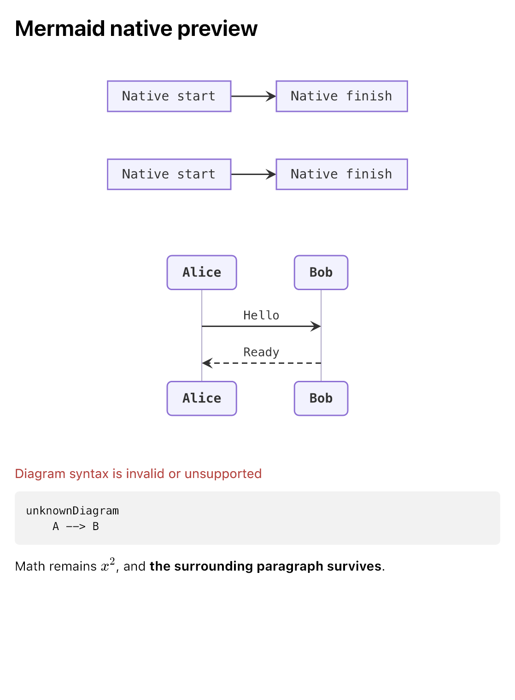

# Mermaid benchmark and validation

Measured on an Apple M4 Pro, macOS 26.6.2 arm64, Rust 1.96.0, using pinned rusty-mermaid 0.2.0 on 2026-10-12. Release profile: thin LTO, one codegen unit. Each case has at least 200 ms of in-process warmup followed by 101 measured samples. No renderer cache is used.

## Results

| Case | Raw SVG median | Native records median | Native records p95 |
| --- | ---: | ---: | ---: |
| 10-node flowchart | 0.121 ms | 0.129 ms | 0.130 ms |
| 50-node flowchart | 0.898 ms | 0.952 ms | 0.967 ms |
| 200-node flowchart | 8.439 ms | 8.575 ms | 8.725 ms |
| Two-message sequence | 0.013 ms | 0.018 ms | 0.018 ms |
| 14-family document | — | 0.462 ms | 0.477 ms |
| 100-diagram document | — | 4.752 ms | 4.829 ms |
| Error recovery document | — | 0.031 ms | 0.031 ms |
| 67,889-byte prose document | — | 1.003 ms | 1.016 ms |
| 1,086,021-byte prose document | — | 16.660 ms | 17.285 ms |

The full [CSV](results.csv) includes p95, maximum, input size, and a code-fence baseline. [Environment and source hashes](environment.json) identify the measured inputs. Flowchart cases are linear chains with labeled nodes; they do not represent all possible graph topologies. Each stage is measured in a separate warmed block, so small differences between raw SVG and records can include scheduling, allocator, and CPU-frequency effects. No inference should be drawn by subtracting these separately measured stages.

`svg` measures rusty-mermaid parsing, layout and SVG serialization. `records` measures the actual native ABI path: UTF-16 decoding/copying, Markdown parsing, diagram rendering, SVG URL encoding, immutable record construction, and result destruction. UTF-16 fixture preparation occurs before timing. Math rendering is not included in these benchmark inputs.

`code_baseline` replaces Mermaid fence languages with `text`, preserving their bodies and surrounding Markdown. It measures ordinary Markdown code-block processing in the same new binary; it is not a comparison against the previous app version. For the 100-diagram document, the baseline and rendered timings show the additional work of diagram layout and serialization.

These are CPU pipeline timings, not visible edit or opening latency. They exclude Swift adoption, the retained document tree, image decoding, Ultralight geometry/painting, AppKit, and display scheduling. Larger or more densely connected diagrams can take longer. The input size/line limits are not a render-time guarantee.

## Reproduce

From the repository root:

```sh
cargo run --release --locked --manifest-path Native/Comrak/Cargo.toml \
  --target-dir .build/comrak --example mermaid_benchmark -- 101 \
  > benchmarks/mermaid/results.csv
```

The optional final argument changes the number of samples. Keep other CPU-intensive tasks idle while measuring. Dependencies are pinned by the native Cargo manifest and lockfile. The harness embeds the checked fixture documents and generates the flowchart/prose cases deterministically. Builds and process startup are excluded from its timed samples.

## Validation

The complete `bash scripts/check-preview.sh` gate passed for this implementation:

- KaTeX inline/display, matrices, errors, and untrusted-input checks.
- 11 Rust tests, including eight new Mermaid tests.
- 34 Swift debug tests and 32 Swift release tests, including four new Mermaid tests. Every fixture SVG is parsed as XML.
- Release packaging and audit, including absence of test controls and development artifacts.
- Native Mermaid image pixels/geometry, repeated diagrams, math, resize, error recovery, edit, undo, and redo.
- Existing native bounded-preview, parser/presentation recovery, retained navigation, rapid typing, edit, resize, and synchronized-scroll checks.

The [validation log](validation.log) records the run. The intentionally injected parser-failure messages near its end are part of successful recovery checks. Graphical checks were run outside the command sandbox after its app launch was aborted; they completed successfully in the graphical Mac session.



The captured native preview was visually inspected. See the [Mermaid guide](../../docs/mermaid.md) for the broader fixture corpus, manual inspection steps, and compatibility limitations.
