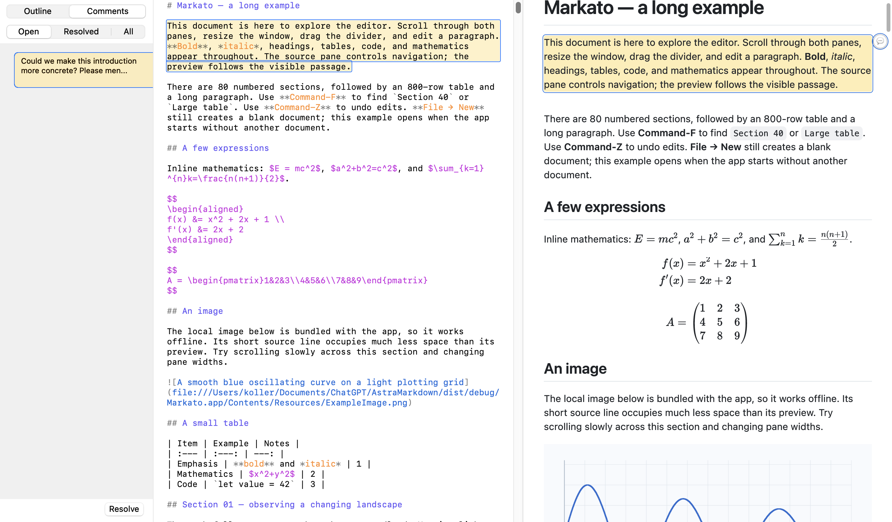
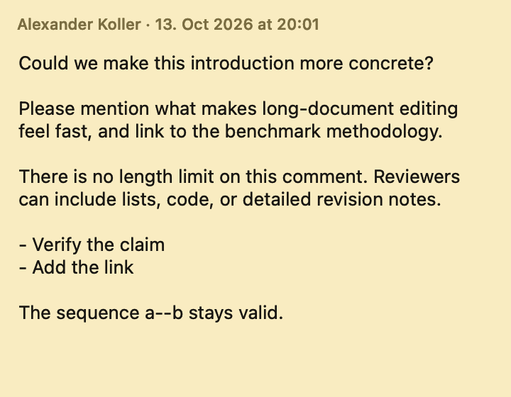

# Comments

Markato stores review comments in the Markdown file itself. Choose **Edit → Add Comment** (⇧⌘M) with text selected to create a highlighted comment, or without a selection to create a point comment. A yellow card opens beside the selection so the comment can be written in place. Return saves and closes it; Shift-Return inserts a newline. The Comments sidebar filters Open, Resolved, or All comments and shows fixed-size yellow cards with wrapped, abbreviated comment snippets—never repeated document text. Selecting a card jumps to its anchor and outlines the matching yellow source highlight, preview highlight, and speech bubble. The bubble opens the full, unrestricted comment in the same editable, scrollable yellow card with its author and date at the top. Comments can be resolved or reopened from the sidebar.





PDF export converts the comments to standard PDF highlight or text-note annotations. HTML export and ordinary Markdown renderers omit them because each record is an HTML comment.

## File format

Comment records form a footer after the document content. Markato collapses that footer to a compact disclosure row in the source editor by default, while preserving its text verbatim in the Markdown file. Expand the disclosure to view and edit the literal HTML comment records, then collapse it again to return to the summary. Each record has a versioned marker followed by JSON:

```markdown
<!-- markato-comment:v1
{
  "anchor" : {
    "exact" : "text under review",
    "position" : 42,
    "prefix" : "context before ",
    "suffix" : " context after"
  },
  "author" : "Reviewer",
  "body" : "An unrestricted Markdown comment.",
  "created" : "2026-10-13T10:20:00Z",
  "id" : "90F5C8E8-DB32-4BA8-B152-EEC720A444CF",
  "status" : "open"
}
-->
```

`exact`, `prefix`, and `suffix` are quote selectors. Markato uses them to reattach a comment after nearby edits, with the UTF-16 `position` as a disambiguating hint and a fallback for point comments. `status` is either `open` or `resolved`, and `body` may be arbitrarily long.

When a requested range crosses Markdown syntax nodes and therefore cannot be represented by one valid inline HTML highlight, Markato expands it to the smallest prepared top-level block or blocks that contain it. Such anchors include `"extent" : "blocks"`; the source and preview then highlight the same normalized paragraphs, list, table, or other rendered blocks. Plain-text ranges remain exact and do not carry this field.

Consecutive hyphens in JSON strings are escaped as JSON Unicode escapes so the enclosing HTML comment remains valid. Tools should decode the JSON normally, preserve unknown future records, keep records at the end of the file, and use a fresh stable `id` when generating a comment. This deliberately simple envelope lets Codex, Claude, and other text-oriented tools read or create comments without a proprietary sidecar file.
