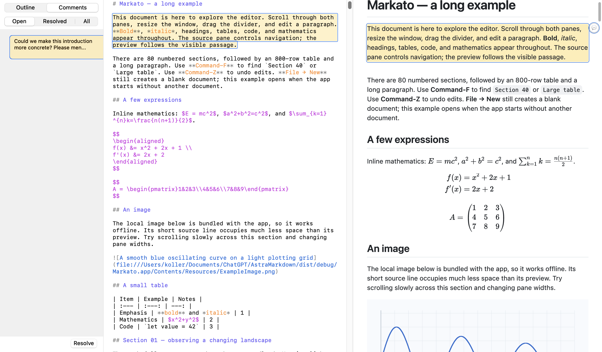
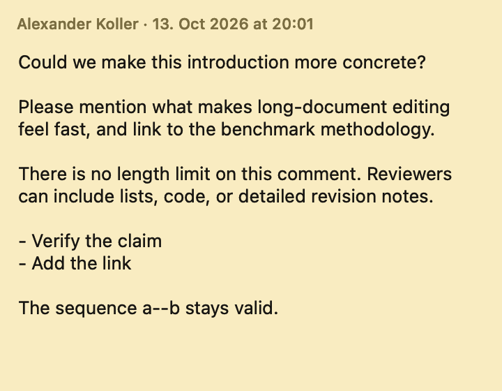

# Comments

Markato stores review comments in the Markdown file itself. Choose **Edit → Add Comment** (⇧⌘M) with text selected to create a highlighted comment, or without a selection to comment on the containing block. A yellow card opens beside the selection so the comment can be written in place. Return saves and closes it; Shift-Return inserts a newline. The Comments sidebar shows fixed-size yellow cards with wrapped, abbreviated comment snippets—never repeated document text. Selecting a card jumps to its anchor and outlines the matching yellow source highlight, preview highlight, and speech bubble. The bubble opens the full, unrestricted comment in the same editable, scrollable yellow card. Resolving a comment removes its inline record; Undo and version control retain its history.





PDF export converts the comments to standard PDF highlight or text-note annotations. HTML export and ordinary Markdown renderers omit them because each record is an HTML comment.

## File format

Each comment record sits immediately after the Markdown block it discusses. The human-written comment comes first, followed by its selector; the terminal `markato-comment:v3` tag identifies the record. The short quoted selector identifies a precise range inside that block; a record with an empty selector applies to the block as a whole. Long or multi-block anchors store only identifying start and end strings with an ellipsis between them, keeping the comment itself prominent. An optional `=> "rendered text"` clause appears only when Markdown syntax requires a rendered-text selector for precise preview highlighting.

```markdown
Text under review remains ordinary Markdown.

<!-- An unrestricted Markdown comment. | "Text under review" | markato-comment:v3 -->
```

```markdown
<!-- The comment stays readable. | "First identifying words" ... "last identifying words." | markato-comment:v3 -->
```

A one-line comment is therefore one line in the file. Long comments wrap in
the source panel, and multiline comments keep all their visible line breaks;
the full body is also available in the comment card. There is no author field
in the persisted record.

While the document is edited in Markato, the live anchor range follows insertions, replacements, deletion, Undo, and Redo. Markato then rewrites only the adjacent record's quoted selector or endpoint pair. Edits elsewhere merely shift the retained ranges and do not rescan the document. If an edit creates a competing endpoint pair before the record, Markato lengthens the endpoints; if no allowed pair is unique, it stores the exact anchor instead. When another editor changes the quoted text, Markato first looks for the nearest matching quote—or the nearest ordered endpoint pair—before the record; if it cannot find one, the comment widens to the adjacent block instead of being discarded.

When a requested range crosses Markdown syntax nodes and therefore cannot be represented by one valid inline HTML highlight, Markato expands it to the smallest prepared top-level block or blocks that contain it. The file stores only that source range. Preview highlighting is derived from the current parse: it is inline when the range is representable in one rendered block and falls back to the intersected block roots otherwise. Consequently, joining or splitting paragraphs changes the presentation without adding stale layout metadata to the comment record.

Authors, timestamps, persistent identifiers, and resolved state are deliberately absent. The record's location supplies its identity while the document is open, and resolving deletes the record. Consecutive hyphens are escaped as `-\-` so the enclosing HTML comment remains valid; literal backslashes are doubled, making the encoding reversible. Markato continues to read the former `v1` JSON footer and `v2` block formats. Editing a legacy record rewrites it in the compact `v3` syntax at its existing location; newly created comments are always block-adjacent.

Verbose `v3` records created by earlier Markato builds are migrated in place to endpoint selectors after their full anchor resolves. This changes only the adjacent HTML comment, not the reviewed Markdown.
