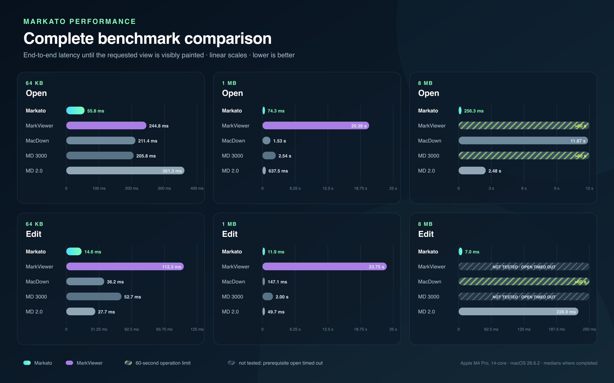

# Markato performance

Markato is designed to keep the work performed for the visible preview bounded,
even when the source document is large. On the benchmark machine, an 8 MB
Markdown file reached a visible preview in **256.3 ms**. That was **9.7 times
faster than MacDown 2.0** and **46 times faster than MacDown 0.7.3**. Neither
[MarkViewer](https://markviewer.com/) nor MacDown 3000 finished within the
60-second operation limit.

The website-ready graphic is available as a standalone
[PNG](assets/markato-performance.png), with an editable and resolution-independent
[SVG version](assets/markato-performance.svg).

## Complete benchmark charts

The six panels below visualize every column in the results table. Each uses a
clearly labeled linear scale sized to its benchmark column. Timeout bars are
capped at the end of the relevant panel and retain their explicit `>60 s` label.

Download the complete chart as a website-ready
[PNG](assets/markato-performance-all.png) or editable
[SVG](assets/markato-performance-all.svg).

## Results

Lower is better. Values are end-to-end wall-clock latency, not parser-only or
renderer-only microbenchmarks.

| Application | 64 KB open | 64 KB edit | 1 MB open | 1 MB edit | 8 MB open | 8 MB edit |
|---|---:|---:|---:|---:|---:|---:|
| **Markato, bounded Ultralight snapshot** | **55.8 ms** | **14.6 ms** | **74.3 ms** | **11.9 ms** | **256.3 ms** | **7.0 ms** |
| [MarkViewer 1.8.14](https://github.com/SeungbinBaik/markviewer-releases/releases/tag/v1.8.14) | 244.8 ms | 112.3 ms | 20,384.8 ms | 23,748.5 ms | >60 s timeout | not tested — open timed out |
| MacDown 0.7.3 | 211.4 ms | 36.2 ms | 1,526.2 ms | 147.1 ms | 11,872.3 ms | >60 s timeout |
| MacDown 3000 3000.0.7 | 205.8 ms | 52.7 ms | 2,542.0 ms | 2,004.1 ms | >60 s timeout | not tested — open timed out |
| [MacDown 2.0](https://github.com/xuanji86/MacDown2.0), release build at `e20d2f2` | 361.3 ms | 27.7 ms | 637.5 ms | 49.7 ms | 2,480.7 ms | 228.9 ms |

At 8 MB, Markato's edit reached visible paint in 7.0 ms, compared with 228.9 ms
for MacDown 2.0. Markato presents a bounded first window and now keeps local
edits on that bounded path, while the comparison applications perform more work
before their first preview or edited preview becomes visible. The fastest value
in each completed column is bold.

## Change from the prior Markato snapshot

The October 12 interface rerun used the same probe, fixture bytes, window size,
and visible-paint endpoint as the earlier Markato snapshot.

| Condition | Prior | Current | Change |
|---|---:|---:|---:|
| 64 KB open | 92.1 ms | 55.8 ms | 39.5% faster |
| 64 KB edit | 33.9 ms | 14.6 ms | 57.1% faster |
| 1 MB open | 79.5 ms | 74.3 ms | 6.5% faster |
| 1 MB edit | 54.7 ms | 11.9 ms | 78.3% faster |
| 8 MB open | 359.8 ms | 256.3 ms | 28.8% faster |
| 8 MB edit | 205.5 ms | 7.0 ms | 96.6% faster |

MarkViewer's own site says it [“launches in under a
second”](https://markviewer.com/markdown-preview-mac). Its 244.8 ms result on the
64 KB fixture is consistent with a fast small-file experience, but that claim
does not define a document size or a visible-content endpoint. Under this
benchmark's common endpoint, MarkViewer took 20.38 seconds at 1 MB and did not
show the 8 MB H1 within 60 seconds. Its 64 KB edit timings were also variable:
the median was 112.3 ms, with individual samples from 59.3 ms to 33.60 seconds.

MacDown 0.7.3's 8 MB open value is the median of three completed opens, whose
times ranged from 11,636.0 to 11,908.9 ms. Its first edit remained busy past the
60-second limit. MacDown 3000's first 8 MB open also remained busy past that
limit, as did MarkViewer's first 8 MB open, so neither 8 MB edit benchmark was
run. The chart labels that state as “not tested — open timed out”; it is not an
edit-time measurement. Later samples were not attempted for those timeout cells.

## What the benchmark measures

The shared application probe exercises the user-visible path:

1. Start a fresh application process and open one warmup document.
2. Measure `open` from the application open request until the first H1 is
   visibly painted in the application's rendered surface. That is the preview
   for split-view applications and MarkViewer's single WYSIWYG editor surface.
3. Insert a unique marker into that H1 and measure `edit` until the changed H1
   is visible in the same rendered surface.

Every application used a 1120 by 760 point window and the same deterministic
64 KB, 1 MB, and 8 MB fixtures. Those are conventional display labels for files
generated to at least the requested byte threshold; complete block boundaries
make the exact files 65,569, 1,048,632, and 8,388,717 bytes. The fixtures contain
no external images, fonts, or network resources. The current Markato cells
report the median of three fresh-process opens and 27 edits, nine per process.
The preserved comparison cells use their original three opens and nine edits.
Each operation had a 60-second limit.

The measurements ran on a 14-core Apple M4 Pro (10 performance and 4 efficiency
cores) under macOS 26.6.2 (Build 25G83). They are a controlled same-machine
snapshot, not a promise about other hardware, documents, versions, or Markdown
feature sets.

## Why Markato scales

Markato does not hand the entire large document to the preview engine before
showing the first screen. It retains the complete source and parsed block
structure, but mounts only a window of semantic blocks around the viewport.
Stable block identities preserve cached HTML and measured geometry across local
edits. A sparse landmark map connects global source positions to the bounded
preview, while background preparation fills cache gaps without replacing the
last coherent presentation.

This architecture changes the critical path from “lay out the whole document”
to “prepare enough correct content to paint the requested view.” Initial parsing
and the retained model still grow with document size, and an intrinsically huge
single block can still be expensive. The detailed invariants and failure behavior
are documented in [How synchronized scrolling works](scrolling-algorithm.md).

## Versions and provenance

- **Markato:** release build from this repository after removing retained Rust
  parser state and avoiding eager interface copies. The raw records and
  aggregates are preserved in
  [`benchmarks/2026-10-12-markato-interface`](../benchmarks/2026-10-12-markato-interface/README.md).
- **MacDown:** version 0.7.3.
- **MacDown 3000:** version 3000.0.7.
- **MacDown 2.0:** release build of commit
  `e20d2f22a01516f08a54d5f9a2135c294a9463d4`. The probe was adapted only at
  the application-open boundary to use its workspace router; the timing start,
  completion test, edit, fixtures, window geometry, and sample counts were
  unchanged.
- **MarkViewer:** official version 1.8.14 DMG, 23,343,129 bytes, SHA-256
  `2dd799c14dab4fb91f9f283f8e01630840b7ac601ef8baa5e9072f9cc497f722`.
  The official app is proprietary, so the probe used a private ad-hoc-signed copy
  of the verified bundle and observed its existing WebKit/ProseMirror surface;
  it did not substitute editor or renderer code. Target documents were delivered
  through standard macOS document routing after the same warmup and two-second
  settling delay used by the shared probe. Automatic update traffic was routed
  to an invalid loopback proxy so it could not perturb measured operations.

Fixture SHA-256 hashes:

| Fixture | SHA-256 |
|---|---|
| 64 KB (65,569 bytes) | `f6f7e3711e99aeac4cea1ba4e98524070881b535be3f075c1394d0fc1ccb1185` |
| 1 MB (1,048,632 bytes) | `3af127c0e280539e0b9c25ff88d1bcbad800aac2d8a5d7e17fa6f64a4c9bb4c3` |
| 8 MB (8,388,717 bytes) | `8e8db8d9ee856bec38d3ae32da8c6c8079ae441c72a71f461c8f7ad044e429ab` |

MacDown 2.0 uses a SwiftUI workspace, TextKit 2, tree-sitter, markdown-it, and a
WebKit preview. Its renderer-only figures are not substituted for the end-to-end
measurements above.

The MarkViewer-specific probe, raw records, and aggregate results are preserved
in [`benchmarks/2026-10-12-markviewer`](../benchmarks/2026-10-12-markviewer/README.md).
